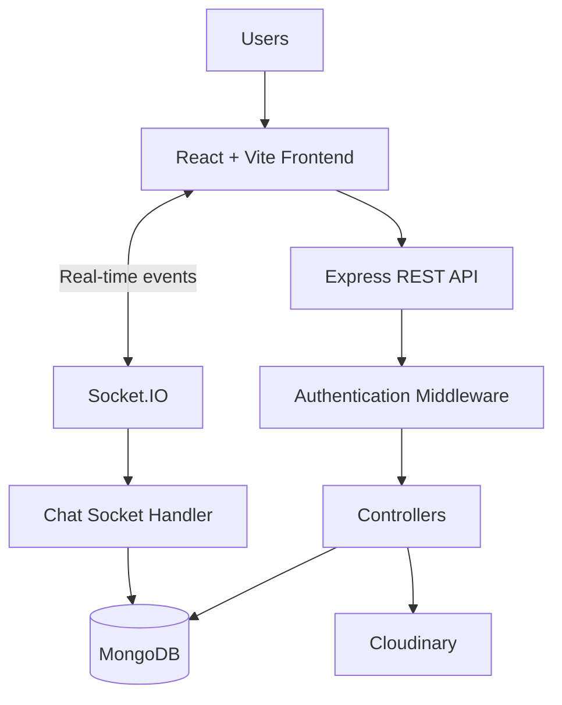

# TripMate — Collaborative Travel Planning & Management

A full-stack web application that makes group travel easier by bringing trip planning, bookings, expense management, real-time communication, and travel memories together in one place.

## Overview

TripMate is a collaborative travel management platform designed for people who travel together. Users can create trips, invite friends and family, plan itineraries, manage booking information, track shared expenses, settle payments, communicate through real-time chat, and share trip memories.

Instead of depending on multiple applications to organize a group trip, TripMate provides a centralized workspace for the entire group.

## Features

### Trip Management
- Create and manage trips.
- Add trip members using their email addresses.
- Manage member roles, including owner, co-organizer, and member.
- View trip details and member information.

### Itinerary Management
- Create and organize day-wise travel activities.
- Add activity details, locations, dates, times, and costs.
- Update and delete itinerary entries.

### Booking Management
- Store and manage trip-related booking information.
- Organize accommodation, transportation, and activity bookings.
- Update booking details.

### Group Expense Management
- Record expenses and track who paid.
- Split expenses using equal, exact, and percentage-based methods.
- View participant payments and outstanding balances.
- Create and track settlements.
- Update remaining balances when settlements are marked as paid.

### Real-Time Trip Chat
- Communicate with trip members through trip-specific chat rooms.
- Send and receive messages in real time.
- Restrict chat access to trip members.
- Store messages in MongoDB.

### Trip Gallery
- Upload trip photos.
- View shared trip memories.
- Delete gallery media.
- Store media using Cloudinary.

### Notifications and Profile
- Receive trip-related notifications.
- Manage personal profile information.

### Authentication and Authorization
- Register and log in securely.
- Password hashing using bcryptjs.
- JWT-based authentication.
- Role-based and trip-membership authorization.

## Technology Stack

| Layer | Technologies |
|---|---|
| Frontend | React 19, Vite |
| Styling | CSS |
| Routing | React Router |
| State Management | Zustand |
| HTTP Client | Axios |
| Backend | Node.js, Express.js |
| Database | MongoDB, Mongoose |
| Authentication | JWT, bcryptjs |
| Real-Time Communication | Socket.IO |
| Media Storage | Cloudinary |
| API Testing | Postman |
| Version Control | Git, GitHub |

## Application Screenshots

Add your actual application screenshots to `docs/screenshots/` and use the following image names.

| Screen | Screenshot |
|---|---|
| Dashboard | `dashboard.png` |
| Trip Details | `trip-details.png` |
| Itinerary | `itinerary.png` |
| Bookings | `bookings.png` |
| Expenses | `expenses.png` |
| Trip Chat | `chat.png` |
| Gallery | `gallery.png` |

Example:

```md

```

## System Architecture



## Project Structure

```text
TripMate/
│
├── client/
│   ├── public/
│   ├── src/
│   │   ├── assets/
│   │   ├── components/
│   │   ├── pages/
│   │   ├── services/
│   │   ├── store/
│   │   ├── utils/
│   │   ├── App.jsx
│   │   ├── App.css
│   │   ├── index.css
│   │   └── main.jsx
│   └── package.json
│
├── server/
│   ├── src/
│   │   ├── config/
│   │   ├── controllers/
│   │   ├── middleware/
│   │   ├── models/
│   │   ├── routes/
│   │   ├── services/
│   │   ├── sockets/
│   │   ├── utils/
│   │   └── server.js
│   └── package.json
│
└── README.md
```

## Installation and Setup

### Prerequisites

Make sure you have the following installed:

- Node.js and npm
- MongoDB Atlas account or a local MongoDB instance
- Cloudinary account
- Git

### 1. Clone the Repository

```bash
git clone https://github.com/Akshaya1827/TripMate.git
cd TripMate
```

### 2. Configure the Backend

```bash
cd server
npm install
```

Create a `.env` file inside the `server` directory.

Add the following configuration:

```env
PORT=5000
NODE_ENV=development
CLIENT_URL=http://localhost:5173

MongoDB_URL=your_mongodb_connection_string

JWT_SECRET=your_jwt_secret
JWT_EXPIRES_IN=7d

CLOUDINARY_CLOUD_NAME=your_cloudinary_cloud_name
CLOUDINARY_API_KEY=your_cloudinary_api_key
CLOUDINARY_API_SECRET=your_cloudinary_api_secret
```

Replace the placeholder values with your own credentials.

### 3. Start the Backend

From the `server` directory:

```bash
npm run dev
```

The backend development server should start on port 5000.

### 4. Configure and Start the Frontend

Open another terminal:

```bash
cd client
npm install
npm run dev
```

Open the local URL displayed by Vite, usually:

```text
http://localhost:5173
```

## Available Scripts

### Frontend

| Command | Description |
|---|---|
| `npm run dev` | Start the Vite development server |
| `npm run build` | Create a production build |
| `npm run preview` | Preview the production build |
| `npm run lint` | Run ESLint |

### Backend

| Command | Description |
|---|---|
| `npm run dev` | Start the server using Nodemon |
| `npm start` | Start the server using Node.js |

## Security Notes

- Never commit `.env` files or private API credentials.
- Keep MongoDB and Cloudinary credentials private.
- Use strong JWT secrets.
- Configure production CORS origins before deployment.

## Future Enhancements

- AI-powered itinerary generation.
- AI travel assistant and chatbot.
- Intelligent hotel and travel booking recommendations.
- Integration with external travel booking APIs.
- Online payment gateway integration.

---

**Repository:** [Akshaya1827/TripMate](https://github.com/Akshaya1827/TripMate)